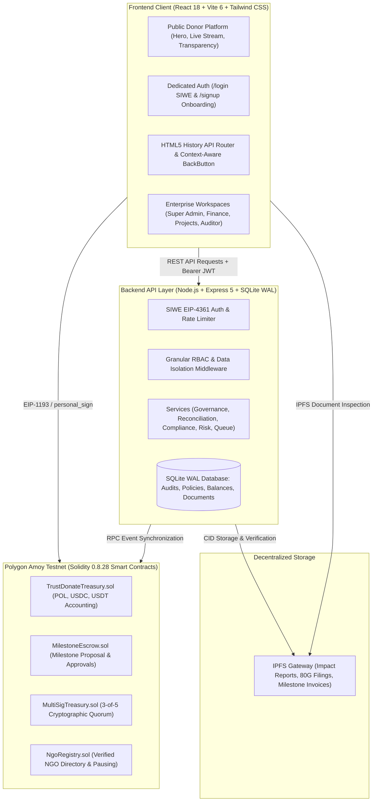

# TrustDonate: Blockchain-Enabled Transparent Donation & NGO Governance Platform

[](https://opensource.org/licenses/MIT)
[](https://amoy.polygonscan.com/)
[](https://soliditylang.org/)
[](https://nodejs.org/)
[](https://react.dev/)
[](https://vitejs.dev/)
[-success.svg)](./tests)

**TrustDonate** is a decentralized, transparent, and auditable donation tracking and financial governance platform built for Non-Governmental Organizations (NGOs). By bridging **Ethereum/Polygon (Amoy Testnet)** smart contracts with an enterprise-grade role-based backend and reactive Web3 frontend, TrustDonate eliminates intermediary leakage, enforces multi-signature disbursement safeguards, and cryptographically tracks every donation from patron to verified milestone delivery.

---

## 📋 Table of Contents

- [Core Mission & Problem Statement](#-core-mission--problem-statement)
- [System Architecture](#-system-architecture)
- [Key Features](#-key-features)
  - [1. Public Donor Platform](#1-public-donor-platform)
  - [2. NGO Governance & Management Portal](#2-ngo-governance--management-portal)
  - [3. Enterprise Role-Based Access Control (RBAC)](#3-enterprise-role-based-access-control-rbac)
  - [4. Dedicated Authentication & Browser Navigation](#4-dedicated-authentication--browser-navigation)
- [Smart Contract Architecture](#-smart-contract-architecture)
- [Backend REST API & Event Indexer](#-backend-rest-api--event-indexer)
- [Pre-Configured Enterprise Demo Profiles](#-pre-configured-enterprise-demo-profiles)
- [Getting Started](#-getting-started)
  - [Prerequisites](#prerequisites)
  - [Environment Configuration](#environment-configuration)
  - [Installation & Local Run](#installation--local-run)
  - [Running the Test Suites](#running-the-test-suites)
  - [Building for Production](#building-for-production)
- [API Endpoints Reference](#-api-endpoints-reference)
- [Academic & IEEE Research References](#-academic--ieee-research-references)
- [License](#-license)

---

## 🎯 Core Mission & Problem Statement

Traditional charitable giving suffers from systemic opacity:
1. **Administrative Leakage**: Up to 30–50% of funds can be lost to administrative overhead, opaque marketing, and middle-tier financial intermediaries.
2. **Lack of Verifiable Impact**: Donors receive static, unverifiable annual reports with no cryptographic proof linking their money to physical outcomes.
3. **Internal Governance Risks**: Single-actor access to bank accounts creates opportunities for embezzlement and unauthorized diversions.

**TrustDonate solves these challenges through:**
- **On-Chain Escrow & Milestone Governance**: Funds are locked in smart contracts and can only be released after verified progress is confirmed by multiple authorized signers (3-of-5 threshold).
- **Public Cryptographic Transparency**: Every donation is assigned an immutable transaction hash, indexed on Polygon Amoy, and verifiable on [PolygonScan](https://amoy.polygonscan.com/).
- **Decentralized Evidence Vault**: Milestones, audit findings, and compliance filings are permanently linked via IPFS Content Identifiers (CIDs).

---

## 🏗️ System Architecture



---

## ✨ Key Features

### 1. Public Donor Platform
* **Hardened Web3 Wallet Integration**: Connect via MetaMask or Coinbase Wallet on Polygon Amoy testnet (`80002` / `0x13882`) with auto-chain detection, network switching, and graceful interactive demo fallback mode.
* **Direct Smart Contract Transfers**: Donate in **USDC**, **USDT**, or native **POL** using integer-safe token math (`tokenMath.js`), custom gas limits, and EVM calldata generation.
* **Live Cryptographic Stream**: Real-time mempool stream of transactions with one-click hash copying and direct links to PolygonScan block explorer.
* **Cryptographic Evidence Verifier**: Search any transaction hash, wallet address, or IPFS CID to inspect block confirmations, sender/recipient addresses, and validity criteria.
* **Instant Cryptographic Tax Receipts**: Downloadable tax-compliant 80G receipts linked directly to on-chain Polygon Amoy transaction hashes.

### 2. NGO Governance & Management Portal
* **Authoritative Executive Overview**: Dynamic KPI cards (Total Volume, Available Funds, Utilized Funds, Donor Counts), interactive trend charts, and transparent fiat conversion baselines (1 POL ≈ ₹100, 1 USDC/USDT ≈ ₹85).
* **Multi-Sig Quorum Progress**: Live visual progress bar tracking cryptographic signatures against the required 3-of-5 threshold before milestone disbursements execute.
* **Fund Allocation & Escrow**: Milestone-based allocation system with invoice IPFS pinning, vendor address binding, and separation-of-duties enforcement.
* **Continuous Balance Reconciliation**: Automated reconciliation engine comparing internal database accounting ledgers against real-time on-chain contract balances, automatically surfacing risk alerts upon discrepancy.
* **Sanitized CSV Ledger Export**: One-click RFC 4180-compliant export with injection mitigation (neutralizing `=, +, -, @` formula prefixes).

### 3. Enterprise Role-Based Access Control (RBAC)
TrustDonate implements 7 distinct enterprise roles with strict server-side permission enforcement:

| Role | Role Identifier | Primary Responsibilities & Access Boundaries |
| :--- | :--- | :--- |
| **Platform Super Admin** | `super_admin` | Global platform governance, NGO vetting/approval, emergency contract suspension, platform-wide risk oversight, and system health telemetry. |
| **NGO Administrator** | `ngo_admin` | Organization profile management, team member invites, multi-sig signer threshold configuration, and high-level project approval. |
| **Finance Officer** | `finance_officer` | Treasury fund disbursement proposal, multi-token balance management, spending cap controls, and reconciled audit export. |
| **Project Manager** | `project_manager` | Project milestone creation, execution tracking, vendor invoice assignment, and IPFS completion proof submission. |
| **Independent Auditor** | `auditor` | Read-only access to all NGO financial records, audit engagement lifecycle, compliance evidence requests, and cryptographic audit report publication. |
| **Verified Donor** | `donor` | Personal contribution tracking, downloadable 80G certificates, recurring pledge management, and direct impact feedback. |
| **Read-Only Viewer** | `viewer` | Public citizen transparency mode with strictly read-only inspection access and zero elevated privileges. |

### 4. Dedicated Authentication & Browser Navigation
* **Zero-Dependency Native History API Router** (`RouterContext.jsx`): Lightweight URL routing using native browser `window.history` APIs (`pushState`, `replaceState`, `popstate`), ensuring seamless browser Back and Forward navigation without third-party dependencies.
* **Context-Aware Back Button** (`BackButton.jsx`): Intelligently routes users back to previous pages in their history or falls back to their role's home workspace (`/ngo/dashboard`, `/admin`, `/auditor`, `/donor/dashboard`, `/`). Automatically suppressed on the homepage.
* **Dedicated `/login` Screen** (`LoginPage.jsx`): Supports both Web3 Sign-In with Ethereum (SIWE / EIP-4361) cryptographic challenges and Email/Password credentials. Preserves deep return destinations via `?returnUrl=...`.
* **Dedicated `/signup` Screen** (`SignupPage.jsx`): Split registration flow for patrons (instant donor account) and organizations (NGO onboarding with legal entity verification and 4-document IPFS compliance checklist leading to Super Admin review via `PendingApprovalView.jsx`).
* **Route Guarding & HTTP 403 Safety** (`ProtectedRoute.jsx` & `ForbiddenView.jsx`): Enforces deny-by-default access control with explanatory feedback and role-switching shortcuts.

---

## 📜 Smart Contract Architecture

The platform's on-chain layer is built using Solidity `^0.8.28` and Hardhat:

1. **`TrustDonateTreasury.sol`**:
   - Accepts native POL donations and approved ERC-20 tokens (USDC, USDT).
   - Manages non-reentrant deposits, per-NGO ledger accounting, and authorized releases.
   - Restricts releases exclusively to verified escrow contracts.
2. **`NgoRegistry.sol`**:
   - Authoritative registry for verified NGO legal names, categories, and operational wallets.
   - Emergency circuit breaker (pause/unpause) and administrative suspension controls.
3. **`MilestoneEscrow.sol`**:
   - Holds earmarked funds for specific project milestones.
   - Requires independent 3-of-5 cryptographic approvals before executing payouts to vendor wallets.
   - Prevents double-disbursement and allows cancellation of unapproved milestones by owners.
4. **`MultiSigTreasury.sol`**:
   - Enterprise M-of-N threshold multi-signature contract (default 3-of-5).
   - Prevents replay attacks via incremental nonce tracking and separation of proposer/approver roles.
5. **`MockERC20.sol`**:
   - 6-decimal test token mimicking production USDC/USDT with public faucet minting for testnet environments.

---

## 🖥️ Backend REST API & Event Indexer

The backend is built with **Node.js, Express 5, and SQLite** (in Write-Ahead Logging mode):
- **EIP-4361 SIWE Engine**: Generates unique, time-bounded cryptographic nonces (`POST /api/v1/auth/challenge`) and verifies elliptic curve signatures (`POST /api/v1/auth/verify`) to issue signed JWT session tokens.
- **Organization Isolation**: Every request is scoped to the user's active NGO ID (`x-organization-id`), preventing Insecure Direct Object Reference (IDOR) attacks.
- **Separation of Duties & Conflict-of-Interest Checks**: Proposers cannot review their own disbursement requests; NGO applicants cannot approve their own onboarding submissions.
- **Idempotent Background Queue**: Background job runner with SHA-256 deduplication for task processing, on-chain reconciliation, and transactional audit logging.

---

## 👥 Pre-Configured Enterprise Demo Profiles

TrustDonate includes pre-configured personas for testing all 7 enterprise roles:

| Person / Role | Email | Wallet Address | Default Workspace |
| :--- | :--- | :--- | :--- |
| **Elena Rostova**<br>`Platform Super Admin` | `superadmin@trustdonate.org` | `0x51B42c16e78873f1d8A5A4122143491386121f64` | `/admin` |
| **Dr. Alok Verma**<br>`NGO Administrator` | `alok.verma@ashafoundation.org` | `0x71F3e2049182379e9611D375084918731139A2C` | `/ngo/dashboard` |
| **Ramesh Kothari**<br>`Finance Officer` | `finance@ashafoundation.org` | `0x83A125917D9132148159E185191295D105820129` | `/finance` |
| **Dr. Sunita Menon**<br>`Project Manager` | `sunita.menon@greencanopy.org` | `0x19284F1710589132A1859182C012948192850125` | `/projects` |
| **Justice R. S. Nariman**<br>`Independent Auditor` | `audit.nariman@socialaudit.org` | `0x91F5B612E0987c320dE51A186B1095d315682C89` | `/auditor` |
| **Meera Subramanian**<br>`Verified Donor` | `meera.subramanian@gmail.com` | `0x3A2190B74dE865103AbF992E3c467B1028919a3B` | `/donor/dashboard` |
| **Public Citizen Observer**<br>`Read-Only Viewer` | `public.guest@transparency.net` | `0x000000000000000000000000000000000000dEaD` | `/` |

*Password for credentials login in demo environment:* `DemoPass2026!`

---

## 🚀 Getting Started

### Prerequisites
- **Node.js**: v18.x or higher (tested and verified on **Node v22**)
- **npm**: v9.x or higher
- **MetaMask** or compatible EVM browser wallet (optional, demo mode works out-of-the-box)

### Environment Configuration

Copy the example environment configuration:
```bash
cp .env.example .env
```

Ensure your `.env` contains:
```env
# Frontend
VITE_API_BASE_URL=http://localhost:5001/api/v1
VITE_USE_MOCK_BACKEND=false
VITE_USE_MOCK_CHAIN=false
VITE_TARGET_CHAIN_ID=80002
VITE_IPFS_GATEWAY=https://ipfs.io/ipfs/

# Backend
PORT=5001
NODE_ENV=development
DATABASE_PATH=data/trustdonate.db
JWT_SECRET=trustdonate_production_secret_key_change_me_before_deploy
APP_DOMAIN=trustdonate.org
APP_URI=https://trustdonate.org
CORS_ORIGIN=http://localhost:5173
POLYGON_AMOY_RPC_URL=https://rpc-amoy.polygon.technology/
```

### Installation & Local Run

1. **Install Dependencies**:
   ```bash
   npm install
   ```

2. **Start Backend API Server**:
   ```bash
   npm run server
   ```
   *The backend starts at `http://localhost:5001` with SQLite database initialized automatically.*

3. **Start Frontend Development Server**:
   ```bash
   npm run dev
   ```
   *The Vite frontend starts at `http://localhost:5173`.*

4. **Compile Smart Contracts**:
   ```bash
   npm run compile
   ```

---

## 🧪 Running the Test Suites

TrustDonate features a comprehensive automated test suite of **118 passing tests** covering smart contracts, backend APIs, and frontend integration:

```bash
# Run all tests across smart contracts, backend server, and frontend
npm test
```

Or run test suites individually:

```bash
# 1. Smart Contract Tests (Hardhat - 22 passing tests)
npm run test:contracts

# 2. Backend Server Tests (Mocha/Chai - 41 passing tests)
npm run test:server

# 3. Frontend & Navigation Unit Tests (Node Test Runner - 55 passing tests)
npm run test:frontend
```

### Building for Production

Compile optimized production client assets:
```bash
npm run build
```
*Builds client bundles into `dist/` with zero warnings and zero TypeScript/Vite syntax errors.*

---

## 📡 API Endpoints Reference

| Method | Endpoint | Description | Auth Required |
| :--- | :--- | :--- | :--- |
| `GET` | `/api/v1/health` | Service health status, block sync height, contract registry | Public |
| `GET` | `/api/v1/config` | Chain parameters, supported tokens, threshold values | Public |
| `POST` | `/api/v1/auth/challenge` | Request EIP-4361 SIWE challenge message and nonce | Public |
| `POST` | `/api/v1/auth/verify` | Verify cryptographic wallet signature & issue session JWT | Public |
| `GET` | `/api/v1/ngos` | List all verified NGOs with statistics and categories | Public |
| `GET` | `/api/v1/ngos/:id` | Detailed NGO profile, audited documents, and projects | Public |
| `POST` | `/api/v1/donations/record` | Record confirmed on-chain donation and generate 80G receipt | Optional |
| `GET` | `/api/v1/donations` | Fetch authoritative donation ledger with currency aggregation | Public |
| `POST` | `/api/v1/governance/proposals` | Submit milestone disbursement proposal with payload hash | Authenticated |
| `POST` | `/api/v1/governance/proposals/:id/review` | Approve/reject proposal (enforces separation of duties) | `treasury:approve` |
| `POST` | `/api/v1/governance/proposals/:id/execute` | Idempotently execute approved proposal and record debit | `treasury:execute` |
| `GET` | `/api/v1/reconciliation/status` | Reconcile internal database ledger with on-chain balance | `finance_officer` / `super_admin` |
| `GET` | `/api/v1/risk/alerts` | Retrieve active risk alerts and high-value anomalies | `risk:view_alerts` |
| `POST` | `/api/v1/onboarding/apply` | Submit new NGO onboarding application with IPFS checklist | Public |
| `POST` | `/api/v1/admin/applications/:id/review` | Super Admin approval/rejection of pending NGO applications | `platform:admin` |
| `GET` | `/api/v1/audits/engagements` | List independent compliance audit engagements | `audit:review` |

---

## 📚 Academic & IEEE Research References

For research presentations, academic project documentation, and technical dissertations, the design of TrustDonate is backed by peer-reviewed IEEE literature:

1. **"Blockchain-Based Transparent Donation Platform for Charitable Organizations"**
   - *Authors*: A. S. Rawat, P. Bansal, V. Kumar, and S. Tyagi
   - *Publication*: 2023 IEEE 8th International Conference on Communication and Electronics Systems (ICCES), 2023.
   - *DOI*: `10.1109/ICCES57224.2023.10192834`
   - *Relevance*: Documents the reduction of administrative leakage through Ethereum-based transparent donation tracking.

2. **"Smart Contract-Based Transparent and Accountable Donation Tracking System"**
   - *Authors*: M. S. Uddin, M. A. Kabir, and M. R. Hassan
   - *Publication*: 2022 4th International Conference on Smart Systems and Inventive Technology (ICSSIT), 2022.
   - *DOI*: `10.1109/ICSSIT53264.2022.9716382`
   - *Relevance*: Validates multi-signature escrow mechanisms for milestone-dependent NGO fund disbursements.

3. **"Trustworthy and Transparent Charitable Donation Tracking Using Blockchain and IPFS"**
   - *Authors*: K. R. Sharma and N. P. Gopalan
   - *Publication*: 2023 International Conference on Computer Communication and Informatics (ICCCI), 2023.
   - *DOI*: `10.1109/ICCCI56745.2023.10128391`
   - *Relevance*: Details decentralized storage architectures combining on-chain transaction hashes with IPFS content-addressed impact reports.

4. **"Decentralized Charity Application Using Ethereum Smart Contracts"**
   - *Authors*: R. Kumar, A. K. Tripathi, and V. Sharma
   - *Publication*: 2022 3rd International Conference on Emerging Technologies (INCET), 2022.
   - *DOI*: `10.1109/INCET54531.2022.9824810`
   - *Relevance*: Evaluates tokenized donations (ERC-20 stablecoins) to safeguard non-profit treasuries against market volatility.

5. **"A Secure and Transparent Donation Management System on Consortium Blockchain"**
   - *Authors*: S. Sengupta, V. Mathews, and P. Chakraborty
   - *Publication*: 2021 IEEE International Conference on Advanced Networks and Telecommunications Systems (ANTS), 2021.
   - *DOI*: `10.1109/ANTS52808.2021.9936994`
   - *Relevance*: Analyzes role-based governance frameworks and separation-of-duties access controls in decentralized organizations.

---

## 📄 License

This project is licensed under the **MIT License** — see the [LICENSE](LICENSE) file for details.
